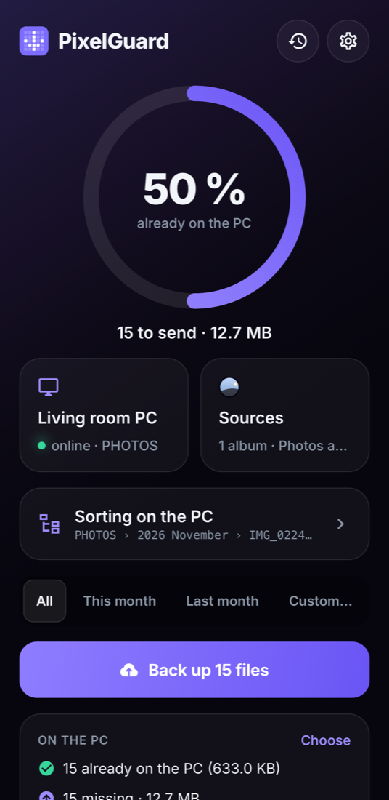
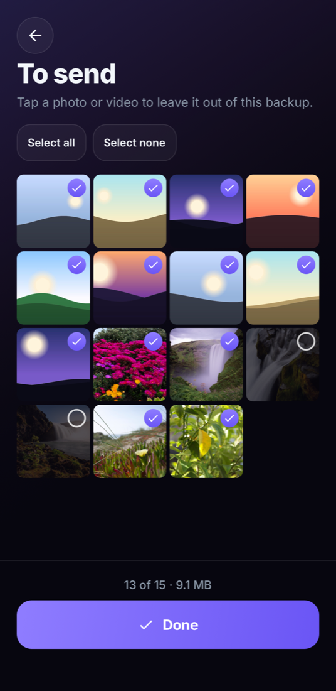
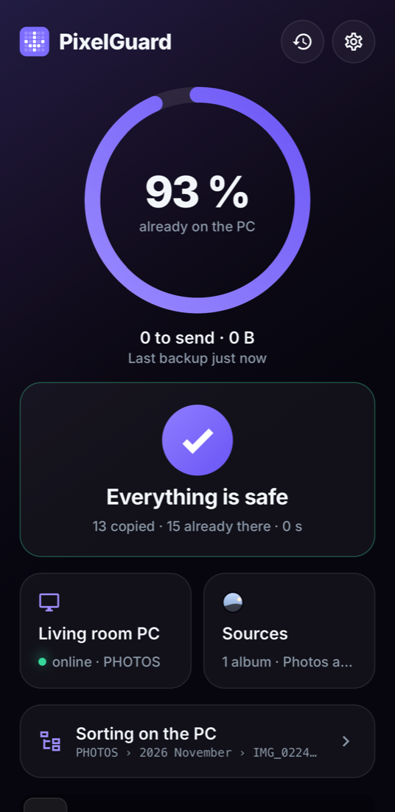
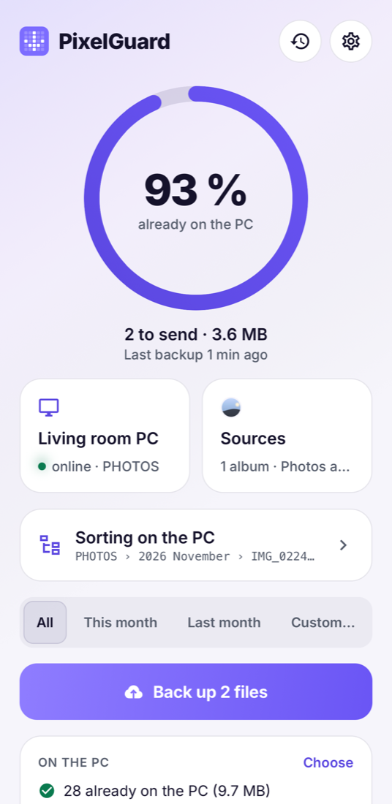

<div align="center">
  
  <h1>PixelGuard for Android and iPhone</h1>
  <p>Back up your phone's photos and videos to your PC over Wi-Fi. No cable, no cloud, no account.</p>
  <p>A private alternative to cloud photo backup: your pictures go straight to a shared folder on your own Windows PC, Mac or NAS (SMB), and nowhere else.</p>

  
  
  
  
</div>

PixelGuard used to be a Windows app that pulled photos from the phone over a USB cable (ADB). It's now [archived](https://github.com/matteogalfre/PixelGuard-old), and this phone app replaces it: the phone sends your photos to a shared folder on your PC, over Wi-Fi, and nothing needs to be installed on the PC. It uses the same folders: with the by-month sorting, what the old app copied isn't copied again.

<p align="center">
  
  
  
  
</p>

## Download

[](https://apps.obtainium.imranr.dev/redirect?r=obtainium://add/https://github.com/matteogalfre/PixelGuard)
[](https://github.com/matteogalfre/PixelGuard/releases/latest)

Obtainium keeps the app up to date straight from this repository's releases. Android 11 or newer. On iPhone, see [below](#iphone).

> Early version: feedback is very welcome, especially with a Windows PC.

## Features

- [x] Sends photos and videos to a shared folder on a Windows PC, a Mac or a NAS (SMB 2 and 3), over your home Wi-Fi
- [x] Pairs with a QR code shown by the PC set-up file, or finds your PC on the network and lists its shared folders
- [x] Pick the albums (Camera, WhatsApp, screenshots...), photos or videos, and the period: everything, this month, last month, the last 3 to 12 months, a year, or from one month to another
- [x] Sorted on the PC the way you like: by month like PixelGuard (`2026 November`), by year, by album, or all in one folder
- [x] Tells you before sending what's already on the PC and what's missing, and lets you untick photos or videos you don't want to send
- [x] Keeps going with the screen off, with a progress notification and a Stop button
- [x] A video cut halfway (Wi-Fi drop, Stop) picks up where it left off next time
- [x] Several PCs (desktop, NAS, Mac): pick where the next backup goes
- [x] A history of past backups: date, files, size, speed
- [x] Skips what's already there, even if the desktop app copied it over USB (with the by-month sorting)
- [x] Encrypted transfers (SMB 3), with the phone's hardware AES
- [x] Frees up space: every copy is read back and compared byte by byte before anything leaves the phone, then Android asks you and moves it to the trash
- [x] Keeps the GPS location of your photos (it asks for the media location permission)
- [x] Copies the PC photos to an external hard drive by itself whenever it's plugged in (set up with the PC file, option [S]), checks every copy, never deletes or replaces anything on the drive, and shows in the app what isn't on the drive yet
- [x] Finds the same photo filed in two places on the PC and suggests which one to keep (the right month from the date taken, then the original name). The others go to a `_Doublons` folder, nothing is deleted
- [x] Checks the copies on the PC against the fingerprint taken while sending, to spot a damaged or missing file early
- [x] A month by month map: on the phone, on the PC, on the hard drive
- [x] Brings photos back from the PC to the phone
- [x] In English or French

## Set up the PC (once)

### Windows

<a href="https://github.com/matteogalfre/PixelGuard/releases/latest/download/PixelGuard-PC.cmd"><b>⬇ Prepare my PC</b></a> (`PixelGuard-PC.cmd`, Windows 10 and 11)

Download it on the PC and double-click it. Windows asks for administrator rights. It may first say "Windows protected your PC": click **More info › Run anyway**. The file isn't signed (signing costs money every year), but it's plain text you can read [here](tools/PixelGuard-PC.cmd) before running it. It downloads nothing and sends nothing. It:

1. shares the folder your photos go to on your local network: `Pictures\PixelGuard` (the same one the desktop app uses), or any folder you pick. It warns you if that folder is synced by OneDrive;
2. creates a `pixelguard` account just for the app, hidden from the sign-in screen, that can only write to that folder. Your own Windows password never leaves the PC, and the Microsoft account and PIN question goes away;
3. allows file sharing on private networks, and offers to switch your Wi-Fi to Private if Windows has it as Public (on Public, the PC stays hidden);
4. shows a QR code: in the app, tap **Scan the PC code** and you're done.

Run it again later to get a new code for another phone, move the photos to another folder, or remove PixelGuard from the PC (your photos stay where they are).

No Internet on the PC, or no way to get the link there? When you add a PC, the app shows a local address like `192.168.1.42:8800`: open it in the PC's browser and the phone hands over the file itself, over your Wi-Fi.

Rather use a terminal? Open **Terminal (Admin)** and run:

```powershell
irm https://raw.githubusercontent.com/matteogalfre/PixelGuard/main/tools/PixelGuard-PC.cmd | iex
```

<details>
<summary>Or with your own Windows account</summary>

Press **Windows + X**, open **Terminal**, paste this line and press Enter. It restarts itself as administrator, creates and shares `Pictures\PixelGuard` with your account, and allows file sharing on private networks. Then sign in from the app with your Windows user and password (with a Microsoft account: your Microsoft e-mail and its password, not the PIN).

```powershell
$s='$d="$env:USERPROFILE\Pictures\PixelGuard"; md $d -Force >$null; if(-not(Get-SmbShare -Name PixelGuard -EA 0)){New-SmbShare -Name PixelGuard -Path $d -FullAccess "$env:USERDOMAIN\$env:USERNAME" >$null}; Get-NetFirewallRule -Group "@FirewallAPI.dll,-28502" | ? Profile -like "*Private*" | Enable-NetFirewallRule; if(Get-NetConnectionProfile | ? NetworkCategory -eq Public){Write-Host "Warning: this network is set to Public on this PC. Switch it to Private (Settings › Network and internet › Wi-Fi), or the phone will not see it." -ForegroundColor Yellow}; Write-Host "PixelGuard is ready: $d" -ForegroundColor Green; Write-Host "User name to type in PixelGuard: $env:USERNAME" -ForegroundColor Green'; if(([Security.Principal.WindowsPrincipal][Security.Principal.WindowsIdentity]::GetCurrent()).IsInRole(544)){iex $s}else{Start-Process powershell -Verb RunAs -ArgumentList '-NoExit','-EncodedCommand',([Convert]::ToBase64String([Text.Encoding]::Unicode.GetBytes($s)))}
```
</details>

### Mac

Nothing to download:

1. System Settings › General › Sharing: turn on **File Sharing**.
2. Click the ⓘ next to it, add a folder (for example Pictures › PixelGuard) and give yourself **Read & Write**.
3. Options…: tick **Share files and folders using SMB**, and your account under **Windows File Sharing**.
4. In the app, pick your Mac in the list and sign in with your Mac account name and password.

To keep your password to yourself, create a **Sharing Only** user (System Settings › Users & Groups › Add User) and use that one.

## How to use

1. Open the app and allow access to your photos (and to their location, so the GPS data is kept).
2. Tap the ⚙ button, then **Scan the PC code** (or pick your PC in the list and sign in).
3. Choose your albums and how files are sorted on the PC.
4. Tap **Back up**.

The phone and the PC must be on the same Wi-Fi. The app refuses any address outside your local network.

## Speed

On a good 5 GHz Wi-Fi you should get tens of MB/s. The app keeps several writes in flight, sends three files at a time, and holds the Wi-Fi in low latency mode while it works. The ⚙ screen has a speed test. A guest Wi-Fi, a repeater or a PC on 2.4 GHz will slow things down a lot; a PC plugged into the router with a cable is best.

Encryption costs some speed: the phone encrypts every packet and the PC decrypts it. The phone itself keeps up easily (AES-GCM at 2.2 GB/s measured on a Galaxy S24+), it's the exchange that gets heavier. At home, on your own Wi-Fi, you can turn it off in the ⚙ screen for the fastest copies; files stay signed, so nobody can change them on the way. The details are in [AUDIT.md](AUDIT.md).

## Privacy and security

- Your photos go straight from the phone to your PC. The app talks to nothing else, not even to check for updates.
- Transfers are encrypted when the PC supports SMB 3 (Windows 10 and 11, macOS). If it doesn't, the app says so when you pair it. Once encryption is on, it never quietly falls back to unencrypted: the backup stops instead.
- The app remembers the name your PC announces when you pair it, and checks it before every sign-in. A device that answers at the same address under another name (a hotel or a friend's Wi-Fi) gets neither your user name nor the answer to your password.
- Your password never travels in the clear, and it's stored encrypted in the Android Keystore. Use a long one: anyone on your network who captures a sign-in could try to guess it offline.
- Nothing is deleted from the phone without a byte by byte check and Android's own confirmation, and it goes to the trash first.

## Run it from source

```bash
npm install
npm test
```

You need Node, Java 17 and the Android SDK. Then build the APK and install it on a phone plugged in over USB:

```bash
npx expo prebuild -p android --clean --no-install
cd android && ./gradlew assembleRelease -PreactNativeArchitectures=arm64-v8a
adb install -r app/build/outputs/apk/release/app-release.apk
```

The screens run in a browser too, with a fake phone (`npx expo start --web`), handy to work on the interface.

How it's organized:

- [`src/app`](src/app): the screens (Expo Router)
- [`src/logic.ts`](src/logic.ts): the rules shared with the desktop app (month from the file name, duplicates, `name (1).jpg`, sorting), tested with `npm test`
- [`src/engine.ts`](src/engine.ts): compare with the PC, back up, free up space
- [`modules/pgnative`](modules/pgnative): the native part. On Android, in Kotlin and Java: it reads the gallery, finds PCs, talks SMB through [smbj](https://github.com/hierynomus/smbj), and handles the Android trash. `jvm-test/run.sh` tests the SMB code against a local test server, no phone needed
- [`modules/pgnative/ios`](modules/pgnative/ios): the same on iPhone, in Swift (PhotoKit) and C. `PgSmb.c` does what the Android SMB code does, on top of [libsmb2](https://github.com/sahlberg/libsmb2). `ios-test/run.sh` tests it on a Mac against the same kind of local server, and `ios-test/run.sh --serve` starts that server to try the app in the iOS Simulator (the address is `127.0.0.1:4445`, user `test`, password `test`)

## iPhone

The same app, with the same screens, runs on iPhone (iOS 16.4 or later). There is no App Store version: you build it on a Mac and install it with [SideStore](https://sidestore.io) and a free Apple ID.

### Install it

You need a Mac with Xcode, Node and CocoaPods, and SideStore already set up on the iPhone (see sidestore.io, it's done once).

```bash
npm install
npx expo prebuild -p ios
xcodebuild -workspace ios/PixelGuard.xcworkspace -scheme PixelGuard -configuration Release -sdk iphoneos -archivePath build/PixelGuard.xcarchive archive CODE_SIGNING_ALLOWED=NO
mkdir -p build/Payload && cp -R build/PixelGuard.xcarchive/Products/Applications/PixelGuard.app build/Payload/ && (cd build && zip -qr PixelGuard.ipa Payload)
```

Send `build/PixelGuard.ipa` to the iPhone (AirDrop, Files), then open SideStore, tap **+** and pick it. With a free Apple ID an app is signed for 7 days: SideStore renews it by itself in the background, as long as it gets the chance to before the 7 days run out. You can also run it straight from Xcode with your Apple ID (plug the iPhone in, pick it, Run), but then the Mac has to sign it again every week.

### What's different on iPhone

- **Keep the app open while it backs up.** The screen stays on. iOS doesn't let an app keep a transfer to a shared folder going in the background: if you switch apps, the backup stops cleanly after a few seconds, and a video cut halfway picks up where it left off next time.
- **Allow local network access** the first time (iOS asks when the app looks for your PC). Without it, no PC is found. You can change it in Settings › Privacy & Security › Local Network.
- **Photos are copied as they are, byte for byte.** iPhone photos are usually HEIC and videos HEVC: Windows shows them with the free [HEIF Image Extensions](https://apps.microsoft.com/detail/9pmmsr1cgpwg) and the HEVC Video Extensions from the Microsoft Store. If you'd rather get JPEG from now on: Settings › Camera › Formats › Most Compatible.
- **Live Photos** arrive as the photo and its short video with the same name (`IMG_1234.HEIC` and `IMG_1234.MOV`). A photo edited in the Photos app arrives twice: the original and the edited version (`IMG_E1234.HEIC`). That's the same as copying an iPhone to Windows with a cable.
- **iCloud "Optimize iPhone Storage"**: photos that only live in iCloud are downloaded by iOS from iCloud before being sent to the PC. That's the only time anything leaves your home network, and it's between your iPhone and Apple.
- **Freeing up space**: iOS asks for confirmation, then puts the photos in Recently Deleted (30 days). A photo only goes if all its files (photo, Live Photo video, edited version) were read back and match.
- Encryption is SMB 3 with AES-CCM, using the iPhone's hardware AES.

## Feedback and contributions

***All contributions are very welcome!*** Bug reports and ideas go [here](https://github.com/matteogalfre/PixelGuard/issues), pull requests are welcome.

## Credits

SMB is handled by [smbj](https://github.com/hierynomus/smbj) (Apache 2.0) on Android, with [Bouncy Castle](https://www.bouncycastle.org/) as a fallback for algorithms the phone doesn't have, and by [libsmb2](https://github.com/sahlberg/libsmb2) (LGPL 2.1 or later, its source is in `modules/pgnative/ios/libsmb2`) on iPhone.

## License

PixelGuard is licensed under the [GNU General Public License v3](LICENSE): you can use, study, change and share it, as long as your version stays open too.
